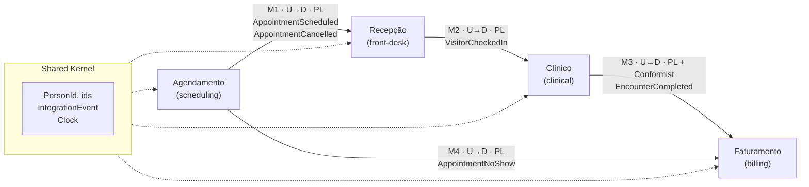
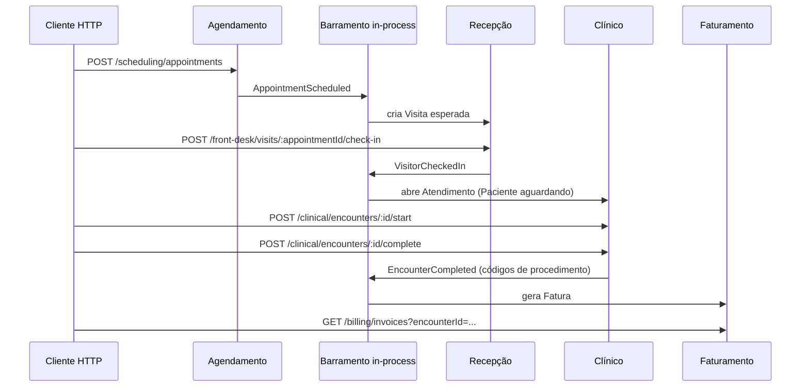

# Mapa de contextos

Estudo de caso: sistema de gestão de uma clínica médica particular. O mapa abaixo é o artefato estratégico do qual as regras de policiamento são derivadas (ver [regras.md](regras.md)). Ele foi escrito antes do código e antes das regras.

## Bounded contexts

| Contexto | Pasta | Responsabilidade | Como enxerga a Pessoa |
|---|---|---|---|
| Agendamento | `src/modules/scheduling` | Agenda de profissionais: marcar, cancelar, registrar não comparecimento | Solicitante (`Requester`) |
| Recepção | `src/modules/front-desk` | Visitas esperadas do dia, check-in, fila de espera | Visitante (`Visitor`) |
| Clínico | `src/modules/clinical` | Atendimento (prontuário do encontro): anamnese, diagnósticos, procedimentos realizados | Paciente (`Patient`) |
| Faturamento | `src/modules/billing` | Tabela de preços, faturas, taxa de não comparecimento | Pagador (`Payer`) |

Os quatro contextos compartilham apenas um identificador, `personId`, definido no Shared Kernel. Nenhum modelo de Pessoa é compartilhado (ver [linguagem-ubiqua.md](linguagem-ubiqua.md)).

## Relações

Todas as relações são de mão única (upstream → downstream) e o grafo é acíclico. Toda relação é materializada por eventos de integração publicados no barramento in-process (`@nestjs/event-emitter`). Não existe nenhuma chamada síncrona entre contextos.

| # | Upstream (U) | Downstream (D) | Padrão | Eventos | Tradução no downstream |
|---|---|---|---|---|---|
| M1 | Agendamento | Recepção | Customer-Supplier + Published Language | `AppointmentScheduled`, `AppointmentCancelled` | Recepção cria/cancela uma Visita esperada (ACL no listener) |
| M2 | Recepção | Clínico | Customer-Supplier + Published Language | `VisitorCheckedIn` | Clínico abre um Atendimento para o Paciente (ACL no listener) |
| M3 | Clínico | Faturamento | Customer-Supplier + Published Language; Faturamento é Conformist quanto ao vocabulário de códigos de procedimento | `EncounterCompleted` | Faturamento gera uma Fatura precificando os códigos |
| M4 | Agendamento | Faturamento | Published Language | `AppointmentNoShow` | Faturamento gera uma Fatura com a taxa de não comparecimento |
| SK | (todos) | (todos) | Shared Kernel mínimo | — | Tipos de identificador, base de evento de integração, relógio |

Observações:

- **Published Language.** Cada contexto publicador tem um arquivo em `src/contracts/` (`scheduling.events.ts`, `front-desk.events.ts`, `clinical.events.ts`) com os nomes dos eventos (constantes) e os payloads. Os payloads são serializáveis (strings ISO, números, arrays de strings), como se atravessassem uma rede. Isso mantém a opção de extrair um contexto para um serviço no futuro.
- **Customer-Supplier.** O downstream influencia o que o upstream publica (por exemplo, Faturamento precisa dos códigos de procedimento em `EncounterCompleted`), mas o upstream continua dono do contrato.
- **Conformist (M3).** O Faturamento não traduz os códigos de procedimento: aceita o vocabulário do Clínico (no mundo real, a tabela TUSS) e mantém só a sua própria tabela de preços indexada por código.
- **Minimalidade do contrato.** `EncounterCompleted` não carrega diagnósticos nem anotações clínicas. O Faturamento não precisa deles, e dado clínico não deve vazar para fora do Clínico.
- **Faturamento não tem downstream.** Clínico não tem relação com Agendamento. Agendamento não consome nada.
- **Recepção publica `VisitorCheckedIn`, não `PatientCheckedIn`.** Na linguagem da Recepção a pessoa é Visitante; quem a transforma em Paciente é o Clínico, ao consumir o evento (ver [decisoes.md](decisoes.md), ADR-004).

## Diagrama

## Eventos publicados e consumidos

| Contexto | Publica | Consome |
|---|---|---|
| Agendamento | `AppointmentScheduled`, `AppointmentCancelled`, `AppointmentNoShow` | — |
| Recepção | `VisitorCheckedIn` | `AppointmentScheduled`, `AppointmentCancelled` |
| Clínico | `EncounterCompleted` | `VisitorCheckedIn` |
| Faturamento | — | `EncounterCompleted`, `AppointmentNoShow` |

## Fluxo principal (ponta a ponta)

## Representação legível por máquina

O mesmo mapa existe em [`context-map.json`](../context-map.json), na raiz. As configurações do dependency-cruiser e do ESLint leem esse arquivo para gerar as regras que dependem das relações (por exemplo, quais contratos cada contexto pode importar). Mudar o mapa muda as regras. Esse é o elo concreto entre o design estratégico e o policiamento.
